# Secure delivery implementation

## Responsibilities and triggers

Application `check.yml` runs on PRs into main and pushes to main. It executes tests,
compilation, final Dockerfile build, Gitleaks, local Semgrep CE rules, and Trivy
source/dependency/configuration scans. PR validation has no environment or registry
credentials. Scanner failures are fatal; vulnerability severity is initially
report-only, visibly recorded as `baseline-report-only`.

`build-image.yml` listens for successful Validate application runs on main and also
supports workflow_dispatch on main. It verifies the originating event is a same-
repository push, requires successful CI for the exact SHA, and rejects stale main
commits. A Docker Buildx single-platform Docker archive is built for linux/arm64.
Java/Node build stages execute on the builder's native CPU; runtime stages do not
RUN ARM binaries. No QEMU is needed for the current Dockerfiles. New ARM RUN steps
would require an ARM runner or explicitly reviewed emulation.

Trivy scans that archive and produces a CycloneDX SBOM. Only after scanning does the
workflow log in to OCIR, load the archive into Docker, check its OS/architecture,
and push it without rebuilding. Remote manifest configuration digest must match
the scanned image configuration. Unique source-SHA/run/attempt tags avoid tag
collisions. GitOps always uses the immutable registry digest.

The build records evidence.json, exact scan/SBOM hashes, source SHA, CI run, build
run, tool pins, archive/config digests and an unsigned in-toto-format build record.
This unsigned record is NOT a signed SLSA attestation. Ordinary private repositories
do not have free GitHub Enterprise artifact attestations.

`promote-image.yml` runs only after successful publication. It revalidates the
build/CI evidence, current source main, registry digest and ARM64 image config.
It creates a new component/run-specific GitOps branch and PR. It changes only the
component Deployment image plus `releases/<component>.json`. It never activates
Applications or pushes to main. It rejects newer open candidates and closes older
bot-owned candidates after creating the replacement. Per-component concurrency
and a final freshness check prevent old jobs overwriting a new branch candidate.
A source commit can advance after any check; rerun evidence checks immediately
before merge if the source has changed. Required checks and review remain essential.

`release.yml` runs for a published semantic GitHub Release, resolves the tag commit,
and attaches the evidence from an existing successful publication. It does not
build, push an image, or promote a deployment. Tags are independent per repository.

In GitOps, `validate-gitops.yml` discovers all active local Application sources,
renders them, rejects placeholders/unapproved application images, runs kubeconform,
Gitleaks and Trivy. Exact external-source exceptions are in `ci/schemas/README.md`.
`verify-promotion.yml` uses pull_request_target only to execute trusted BASE code.
It reads candidate manifests as data through the API and never checks out or runs
candidate code. A separate read-only App authenticates source build artifacts.
The old direct-main promotion workflow is explicitly retired and fails with a
migration message. Manual arbitrary digests are not accepted as build evidence.

## Account-owner setup: two least-privilege GitHub Apps

No App or credentials were created. Do not use a broad personal access token.

1. Create a private **promotion writer** App, installed ONLY on
   `isurunvn/online-store-platform-gitops---k8s-project`.
   Repository permissions: Contents read/write, Pull requests read/write,
   Metadata read. No administration, secrets, workflows, or Actions write permission.
   Configure each application repo with variable `PROMOTION_APP_ID` and secret
   `PROMOTION_APP_PRIVATE_KEY`. The workflow mints a short-lived installation token
   restricted to GitOps and these permissions. Store the key carefully; it is not
   a registry credential and must never enter PR jobs.
2. Create a separate **evidence reader** App installed ONLY on the three application
   repos. Permissions: Actions read, Contents read, Metadata read. In GitOps set
   variable `EVIDENCE_APP_ID` and secret `EVIDENCE_APP_PRIVATE_KEY`. The privileged
   evidence job requests a token only when a PR changes application image fields.
3. Keep existing `prod` OCIR variables and secrets in each application repository:
   OCIR_REGISTRY=phx.ocir.io, OCIR_NAMESPACE=axkouhjvgred,
   OCIR_REPOSITORY=online-store/<component>, OCIR_USERNAME, OCIR_AUTH_TOKEN.
   Prefer a dedicated repository-scoped publisher and separate pull-only Kubernetes
   identity. IAM scope has NOT been changed or proven least-privileged by this work.
   No credentials were rotated. Promotion currently reuses the publisher login for
   read-only image inspection; it can later use a dedicated registry reader.
4. Restrict prod deployment branches to main. Private environment required-reviewer
   availability depends on GitHub plan; a prod label alone is not approval.
5. Protect main: PRs, current required checks, no force push/deletion, restricted
   bypass. Require human approval for bot image promotions. Do not grant the App a
   bypass. GitHub App PRs trigger ordinary PR workflows; GITHUB_TOKEN event behavior
   differs and must not be assumed equivalent.

## Rollout order and first-run blockers

Merge the GitOps implementation PR first after review. It must reach main before
application automation can call its validator. The evidence workflow does not
exist on the old base branch, so bootstrap branch protection initially requires
GitOps validation; add **Promotion evidence** as a required check once this workflow
exists on main and has run. Without this setting, evidence checking is not an
enforced merge boundary. Configure both Apps before relying on automatic promotion.
Then merge application implementation PRs. Successful main CI will publish and open
promotion PRs. Missing App configuration makes promotion fail visibly without
undoing publication. Do not rerun builds merely to retry promotion; rerun the
promotion job for the successful publication instead.

Protect application main with **Application CI** and infrastructure main with
**Terraform CI**. A required independent reviewer may block a solo owner's own
implementation PR; add an actual reviewer rather than bypassing protection.
Never claim the pipeline is production-enforced until GitHub confirms these settings.
Evidence artifacts expire in 90 days. Selected release evidence and backups must
be preserved separately; expired evidence blocks re-promotion and rollback checks.
Existing pre-implementation images have no new evidence and are not grandfathered
into automatic promotion. Review any emergency legacy rollback separately.

## Signing and policy progression

`ENABLE_EVIDENCE_SIGNING=true` enables Cosign keyless signing of the release evidence
blob (which contains the exact image digest). Verification enforces the expected
repository/workflow identity and GitHub OIDC issuer. This is artifact-evidence
signing, not an OCI-native image admission policy. The toggle is OFF by default:
public Sigstore logs expose signing identity metadata for these private repos, so
the owner must opt in. No signatures were published during validation. Verify this
path in a controlled run before enabling it as a mandatory gate. GitOps and release
consumers verify a signature whenever the authenticated evidence declares signing.
Unsigned evidence remains accepted during baseline rollout; enforcing signatures
requires a reviewed policy change. No new OKE admission controller is installed.

See SECURITY-POLICY.md for report-only vulnerability handling and exception rules.
Do not silently turn findings into approvals. The initial source baseline found
115 backend, 98 notification and 5 frontend dependency findings; these are scanner
findings, not 218 independently proven exploitable defects. Triage runtime exposure,
fix availability, reachability and severity before selecting blocking thresholds.

## Local checks and deployment verification

Install tools with `python3 ci/install-tools.py ...` (Linux amd64) and add the printed
path to PATH outside Actions. Tool downloads have pinned checksums. Python tooling
uses pinned direct versions; transitive pip dependencies are not fully hash-locked.
GitOps requires PyYAML 6.0.3. Run `python3 ci/validate.py` and unit tests in `ci`.
All Python helpers are small CI responsibilities, not controllers running in OKE.

After an approved GitOps merge, run from GitOps:

```bash
python3 scripts/verify-deployment.py \
  --context context-devops-prod-cluster-cc4xx4zk64a
```

This reads Argo health/sync, waits for Deployment rollouts, and uses localhost-only
port forwarding for backend/notification health, frontend health, products routing
and Keycloak discovery. It does not write Kubernetes resources or test order/email
side effects. Customer login/checkout remains an explicit functional demo test.
No kubeconfig or cluster-admin credential is installed in application CI.

## Rollback

Open a GitOps PR reverting ONE image and its evidence record to a previously
approved digest. Do not rebuild the old source. For a non-current source commit,
a human maintainer must approve the current PR head, then add `rollback-approved`
to rerun the evidence gate. Only an authenticated successful old build with unexpired
matching evidence is accepted. Required checks and review still apply. Merge then
lets Argo CD reconcile; run smoke checks. Database migrations are not reversed by
an image rollback. Do not automatically roll back incompatible schema changes.

## Architecture

```mermaid
flowchart LR
  PR[Application PR] --> CI[Tests and security checks]
  CI --> Merge[Reviewed main merge]
  Merge --> Build[One ARM64 archive]
  Build --> Scan[Scan exact archive and SBOM]
  Scan --> OCIR[Publish unchanged artifact to OCIR]
  OCIR --> Evidence[Digest and authenticated build evidence]
  Evidence --> GP[GitOps promotion PR]
  GP --> Checks[Static validation and evidence verification]
  Checks --> Review[Human approval and protected merge]
  Review --> Argo[Argo CD auto-sync]
  Argo --> OKE[Kubernetes rollout]
  OKE --> Smoke[Read-only smoke verification]
```



Example: a backend PR passes Application CI, merges, and emits one ARM64 archive.
After scanning, it is pushed with a unique SHA/run tag and recorded by digest. The
promotion writer opens a backend-only GitOps PR. The evidence reader verifies the
successful source/build runs and report hashes. Review and merge change desired
state; Argo CD deploys it. Optional v1.1.0 Release later records the SAME image.

## References checked 31 October 2026

- https://docs.docker.com/build/exporters/
- https://docs.docker.com/build/building/multi-platform/
- https://docs.github.com/en/actions/how-tos/write-workflows/choose-when-workflows-run/trigger-a-workflow
- https://docs.github.com/en/actions/reference/security/securely-using-pull_request_target
- https://docs.github.com/en/actions/how-tos/secure-your-work/use-artifact-attestations/use-artifact-attestations
- https://docs.github.com/en/repositories/configuring-branches-and-merges-in-your-repository/managing-protected-branches/about-protected-branches
- https://docs.github.com/en/actions/reference/workflows-and-actions/deployments-and-environments
- https://docs.sigstore.dev/cosign/signing/signing_with_blobs/
- https://docs.sigstore.dev/cosign/verifying/verify_blob/
- https://docs.oracle.com/en-us/iaas/Content/Registry/Concepts/registrypolicyrepoaccess.htm
- https://docs.oracle.com/en-us/iaas/Content/Identity/api-getstarted/token_exchange_grant_type_workload_id-federation.htm

OCI's JWT/RPST federation documents control-plane access. It does not establish a
replacement for the existing Docker username/auth-token OCIR login, so this work
does not pretend to remove long-lived registry credentials.
